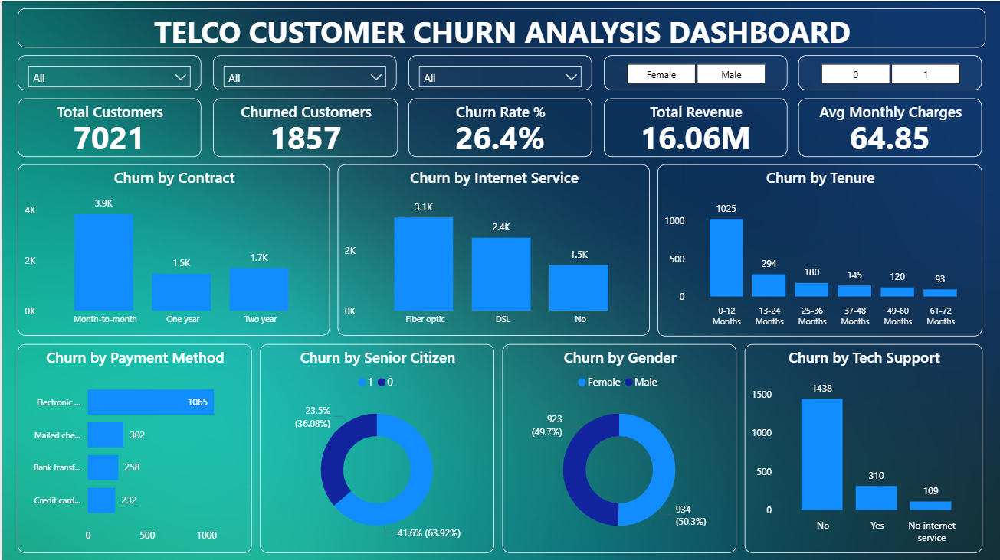

# 📉 Telco Customer Churn Analysis

**Customer Analytics Project using SQL and Power BI**

An end-to-end data analytics project focused on exploring customer churn patterns, customer behavior, service usage, and retention-related metrics using SQL and Power BI.

---

## 📌 Project Overview

Customer churn occurs when customers discontinue a company's products or services. Understanding churn patterns helps businesses investigate customer retention challenges and make informed decisions.

This project analyzes a telecommunications customer dataset using SQL for querying and analysis and Power BI for interactive data visualization. The dashboard presents key customer metrics and enables exploration of churn across contract types, internet services, payment methods, and customer demographics.

## 🎯 Project Objectives

- Analyze customer churn and retention patterns.
- Calculate and present important customer KPIs.
- Explore churn across contract types and internet service categories.
- Examine customer payment methods and monthly charges.
- Compare customer segments using interactive dashboard filters.
- Present analytical findings in a clear, business-friendly format.

## 🛠️ Tools & Technologies

| Tool | Purpose |
|---|---|
| SQL / MySQL | Data querying, filtering, aggregation, and analysis |
| Microsoft Power BI | Dashboard development and interactive visualization |
| CSV | Dataset storage and input data |

## 📂 Project Structure

```text
Telco-Customer-Churn-Analysis/
│
├── Dataset/
│   └── Telco_Customer_Churn.csv
│
├── Power bi/
│   └── Telco_Customer_Churn_Analysis_Dashboard.pbix
│
├── Screenshot/
│   └── Telco-Dashboard.png
│
├── SQL/
│   └── Telco_Customer_Churn.sql
│
├── gradiant.jpg
└── README.md
```

## 📊 Power BI Dashboard

The Power BI dashboard provides an interactive overview of customer churn, helping explore customer retention, service usage, and customer-related metrics.

### Dashboard Preview



### 📌 Key Performance Indicators (KPIs)

- **Total Customers:** Displays the total number of customers included in the analysis.
- **Churned Customers:** Shows the number of customers who discontinued the service.
- **Churn Rate (%):** Measures the percentage of customers who churned.
- **Total Revenue:** Presents the revenue metric calculated in the dashboard.
- **Average Monthly Charges:** Shows the average monthly charges across customers.

### 🎛️ Interactive Filters

The dashboard includes slicers to explore customer churn across different categories:

- **Contract:** Compare churn patterns across contract types.
- **Internet Service:** Explore churn across internet service categories.
- **Payment Method:** Investigate churn patterns by payment method.
- **Gender:** Compare churn across gender categories.
- **Senior Citizen:** Explore churn patterns for senior and non-senior customers.

### 🔍 Dashboard Analysis

The dashboard supports exploration of:

- Customer retention and churn distribution.
- Churn patterns across contract types.
- Differences across internet service categories.
- Churn distribution by payment method.
- Customer segmentation using demographic and service-related filters.
- Monthly charges and revenue-related metrics.

### 💡 Business Value

The dashboard helps identify customer segments with higher churn, investigate potential retention challenges, and support data-informed decisions about customer experience and retention strategies.

The dashboard highlights patterns in the available data; it does not independently establish the causes of customer churn.

### 📥 Download the Power BI Dashboard

[**Download the Power BI Dashboard (.pbix)**](Power%20bi/Telco_Customer_Churn_Analysis_Dashboard.pbix)

## 🧮 SQL Analysis

SQL is used to query and analyze the Telco Customer Churn dataset, explore customer information, and investigate churn patterns across service and customer categories.

### 🎯 Objectives of SQL Analysis

- Explore the customer dataset.
- Analyze customer churn and retention patterns.
- Compare churn across contract types.
- Examine internet service categories and payment methods.
- Analyze customer-related metrics and monthly charges.
- Generate summarized results to support business analysis.

### 🔎 Areas of Analysis

**1. Customer Overview**

Explore customer records and summarize the customer base.

**2. Churn Analysis**

Examine churned and retained customers and summarize churn distribution.

**3. Contract Analysis**

Compare customer churn across available contract categories.

**4. Internet Service Analysis**

Explore customer churn across internet service types.

**5. Payment Method Analysis**

Investigate how churn is distributed across payment methods.

**6. Charges Analysis**

Analyze monthly charges and related customer metrics.

### 🛠️ SQL Techniques

Depending on the queries included in the SQL script, techniques may include:

- `SELECT` and `WHERE` for retrieving and filtering records.
- `GROUP BY` for category-level summaries.
- Aggregate functions such as `COUNT()`, `SUM()`, and `AVG()`.
- `ORDER BY` for sorting results.
- `CASE WHEN` for conditional analysis, where applicable.

### 📄 SQL Script

[**View Telco Customer Churn SQL Analysis**](SQL/Telco_Customer_Churn.sql)

## 📁 Dataset

The dataset used for this project is available in the `Dataset` folder.

[**View Telco Customer Churn Dataset**](Dataset/Telco_Customer_Churn.csv)

The data contains customer and service-related information used to explore churn patterns and customer behavior.

## 📈 Key Business Questions

This project explores questions such as:

- How many customers have churned?
- What percentage of customers have churned?
- How does churn vary across contract types?
- How does churn differ across internet service categories?
- How is churn distributed across payment methods?
- Which customer segments may warrant further retention analysis?

## 💡 Key Takeaways

The project provides a practical view of customer churn analysis by combining SQL-based data exploration with Power BI visualization.

It demonstrates how customer metrics, category comparisons, and interactive filters can help users investigate retention patterns and identify areas for further analysis.

Specific business conclusions should be based on the results observed in the dataset and dashboard.

## 🚀 How to Explore This Project

1. Review the dataset in the `Dataset` folder.
2. Open the SQL script in the `SQL` folder.
3. View the dashboard preview in the `Screenshot` folder.
4. Download the `.pbix` file from the `Power bi` folder.
5. Open the dashboard in Power BI Desktop to explore its visuals and filters.

## ✅ Conclusion

This project demonstrates how SQL and Power BI can be used together to analyze customer churn and explore customer behavior in the telecommunications industry.

SQL supports data exploration and customer-level analysis, while Power BI transforms the results into an interactive dashboard with key performance indicators and filters for exploring churn across different customer segments.

The project strengthened my practical skills in data analysis, SQL querying, KPI reporting, and dashboard development. It also demonstrates how data visualization can help businesses investigate customer retention patterns and make informed decisions.

**Key takeaway:** Turning customer data into meaningful insights can help organizations better understand churn patterns and identify opportunities for further retention analysis.


## 👩‍💻 About Me

**Ketki Mahajan**  
Aspiring Data Analyst | Python | SQL | Power BI

[LinkedIn](https://www.linkedin.com/in/ketki-mahajan-3484973b9/) · [GitHub](https://github.com/ketki-mahajan)
